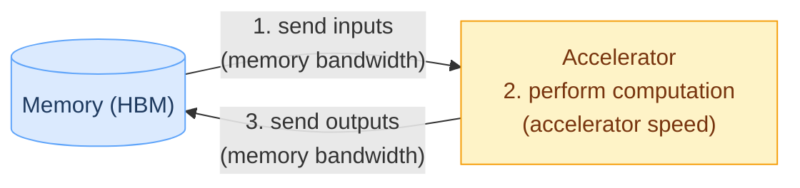
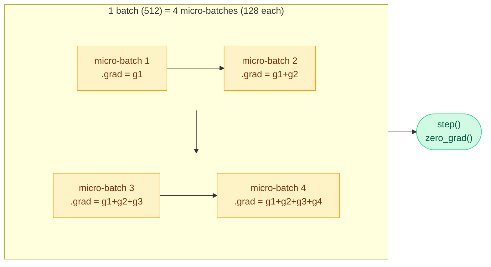
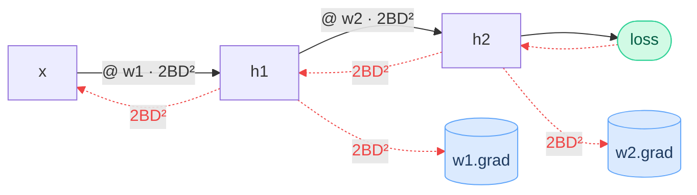

## Program
### PyTorch tensors
- [[0_Tensor Core Mental Model]], [[1_Create]] for tensor basics
- [[2_Deep Learning]], [[Backpropagation]], [[Epoch_Batch]] for basics DL knowlege & code

### einops
- built on top of torch, einsum notation style tensor calc, see [[einops]] for basics syntax
- `einsum`
	Multiply dimensions that have same name, then **sum** over dimensions that appear in the inputs but disappear from the output
- can use `...` for broadcasting over several number of dimensions

**Motivation: Feed forward Net**
- Sequence of **linear transformations + activation functions**.

$$\begin{gather}

Y = a(XW + b) \\ 
X:[B,I],W:[I,H],b:[H],Y:[B,H]
\end{gather}$$


- a = activation
- X = input (batch, input dim)
- W = weight (input, hidden dim)
- b = bias (hidden dim)
```python
# original
Z = X @ W + b

# einops
Z = einsum(
	X, W, 
	"batch input, input hidden -> batch hidden"
	) + b

```

**Motivation 2: Pairwise dot product**
- Similar to the query-key dot product in attention
- strength: describe which dimensions interact directly, without manually transposing/rearranging tensors first
```python
# torch
for b in batch:
    z[b] = x[b] @ y[b].T

# einops
z = einsum(
    x, y,
    "batch seq1 hidden, batch seq2 hidden -> batch seq1 seq2"
)
# > dot product over hidden
```

# Compute speed
depends on (0) data type (1) accelerator speed and (2) memory bandwidth

<!-- One computation: inputs move memory -> accelerator, get computed, outputs move back to memory -->



## Data types
- almost everything are stored as float (weights, bias)
- details: [[Numeric dtypes _ memory usage]]
	- reduce precision (BF16) or magnitude (FP16) -> <span style="color:rgb(255, 0, 0)">save time & memory</span>
- mixed precision training:
	- fp32 for key parts (eg. optimizer states)
		- note: max required precision for DL is fp32
	- bf16/fp16/fp8 for parameters/activation/gradients
		- less stable (over/under-flow etc)
		- rec to just touch FP32 & BF16
	- PyTorch has built-in to cast things when safe (AMP)
## Accelerator speed
depend on datatype & hardware 
### FLOPs (<span style="color:rgb(255, 0, 0)">flo</span>ating-point <span style="color:rgb(255, 0, 0)">op</span>eration)
- def: <span style="color:rgb(255, 0, 0)">num of basic operations</span> (`+-*/`) <span style="color:rgb(255, 0, 0)">needed to train DL model</span>
	- for hardware optimization, `+` and `*` have similar efficiency 
- <span style="color:rgb(255, 0, 0)">FLOP/s</span>: floating-point operations per second (also written as FLOPS sometimes)
	- for hardware measurement (**dtype** matters a lot!)
	- need to **divided by 2** IF it's a peak performance **with sparsity**
		- eg. H100: 1979 teraFLOP/s $\rightarrow$ `h100_flop_per_sec = 1979e12/2`
- common operations
	- mostly won't encounter operation more expensive than matmul
	- forward pass FLOPs: exact for linear layer, good approx. for transformers

| operation                                | big O                                                                  | FLOPs                                                                                                                           |
| ---------------------------------------- | ---------------------------------------------------------------------- | ------------------------------------------------------------------------------------------------------------------------------- |
| element wise <br>($m \times n$)          | O(m n) $\propto$ <span style="color:rgb(255, 0, 0)">matrix size</span> | $mn$ (× ops per element, eg. add = 1)                                                                                           |
| matmul <br>($B \times D$ @ $D \times K$) | O(B D K)                                                               | $2 \times B \times D \times K$<br>(<span style="color:rgb(255, 0, 0)">each $BK$ outputs needs $D$ multiplies + $D$ adds</span>) |
| forward pass                             | O(B D K)                                                               | $2 \times B \times (D \times K)$<br>- $B$ = num data points = num tokens for LLMs<br>- $D \times K$ = num params                |

### MFU (Model FLOPs utilization)
- def: $$mfu = \frac{\text{actual flops per sec}}{\text{promised flops per sec}} $$
- mfu > 0.5 are quite good (higher if matmul dominate), possible to get 0.1
	- see arithmetic intensity 
- to make cuda calculation to wall-clock time, need to set operation to sync
	- operations are async by default (switch btw cpu/cuda)
	- detail: [[Asynchronous programming#PyTorch GPU timing]]
- torch.cuda.synchronize() or `.item()` are <span style="color:rgb(255, 0, 0)">block task</span> (similar to `await`), make cpu stop until gpu kernel finish
## Memory Bandwidth
- def: <span style="color:rgb(255, 0, 0)">bytes moved per sec</span> btw memory (HBM) & compute units
- $\propto$ speed to move data (`bytes_per_sec`)
	- think of it as pipe width: wider pipe -> more data per sec
- bytes moved = num elements × bytes per float
	- 1 byte = 8 bits -> bf16 = 2 bytes, fp32 = 4 bytes
### Memory of MLP
- using [[#Gradient Descent (MLP)]] as example
- eg. assume number of parameters of the MLP is `n`
	- parameter memory = $2 \times n$ (2 bytes for bf16)
	- activation (intermediate output) memory = $2 \times B \times D \times L$ (bf16)
	- gradient memory = $2 \times n$ (bf16)
	- optimizer state memory = $4 \times n$ (customary to use <span style="font-weight:bold; color:rgb(255, 0, 0)">fp32</span> for stability $\because$ accumulating avg over power)
		- Adam needs $8 \times n$ for storing 1st & 2nd moments
$\rightarrow$ total memory = parameter memory + activation memory + gradient memory + optimizer state memory
- performance-wise: memory is NOT a bottleneck
- size-wise: this is why models can NOT be fit easily

### Memory Optimization
Typically two things people usually do
#### Gradient Accumulation
- problem: we want a large batch (eg. 512) for stable gradient, but 512 examples don't fit in activation memory ($\propto B$)
- sol: split 1 batch into k micro-batches, forward + backward each **without zeroing .grad** in between.
- trade-off: **slower** (micro-batches run sequentially)



- peak memory = 1 micro-batch, gradient = full batch
- divide loss by `accum_steps` -> summed grad = mean over full batch
```python
for i, (x, y) in enumerate(loader):              # micro-batches of 128
    loss = loss_fn(model(x), y) / accum_steps    # accum_steps = 4 -> batch 512
    loss.backward()                              # .grad += micro-batch grad
    if (i + 1) % accum_steps == 0:
        optimizer.step()
        optimizer.zero_grad()
```

#### Activation Checkpointing
- == gradient checkpointing / rematerialization
- problem: backward needs every layer's activation, but storing all L layers costs a lot memory
- sol: forward <span style="color:rgb(255, 0, 0)">keep only subset of activations (= checkpoints)</span> $\rightarrow$ backward **recompute** missing activations from nearest checkpoint
- trade-off: **re-compute to save memory**
- eg. keep h2, h6, h9 -> when needs h7, h8 -> recompute from h6 
	-  blue = checkpoint (kept), grey = dropped after use, red = recomputed in backward


- different checkpoint save frequency

| save frequency                                                                 | activation memory | recompute                                                                                  |
| ------------------------------------------------------------------------------ | ----------------- | ------------------------------------------------------------------------------------------ |
| store all                                                                      | $O(L)$            | none                                                                                       |
| store none                                                                     | $O(1)$            | each layer recomputes from x -> $1 + 2 + \dots + L \approx L^2/2$ -> $O(L^2)$              |
| every $\sqrt{L}$ layers (<span style="color:rgb(255, 0, 0)">balanced</span>)  | $O(\sqrt{L})$     | $\sqrt{L}$ layers per segment -> ~1 extra forward in total ($6 \rightarrow 8$ × tokens × params) |

```python
from torch.utils.checkpoint import checkpoint, checkpoint_sequential

# per layer: keep only x (layer input), recompute layer internals in backward
x = checkpoint(layer, x, use_reentrant=False)

# every sqrt(L) layers (model = nn.Sequential of L layers)
x = checkpoint_sequential(model, segments=int(L ** 0.5), input=x, use_reentrant=False)
```

# Find the bottleneck
- Pre-assumption
	We <span style="color:rgb(255, 0, 0)">can overlap communication & computation time near-perfectly</span> because GPU nature 
	(gpu has different chunks, think about each chunk as a async switch)
$$\text{total time} \approx \max(\text{communication time}, \text{computation time})$$
- pre-requisite for calculation
	- flop_per_sec
	- bytes_per_sec

## Arithmetic intensity
- def: **FLOPs done per byte being moved** -> property of the <span style="color:rgb(255, 0, 0)">computation</span>
	- intuition: how much work we squeeze out of each byte we load
$$\text{arithmetic intensity} = \frac{\text{FLOPs}}{\text{bytes moved}} \quad (\text{FLOP/byte})$$
- higher the better (saturate GPU usage)
	- the reason low MFU $\rightarrow$ 
- eg. assume below use bf16 (2 bytes/float)

| operation                            | FLOPs      | bytes moved                                  | intensity                                       |
| ------------------------------------ | ---------- | -------------------------------------------- | ----------------------------------------------- |
| ReLU ($n$ elements)                  | $n$        | $2n + 2n$ <br>(read + write)                 | $0.25$<br>(memory bound)                        |
| matmul ($B \times D$ @ $D \times K$) | $2BDK$<br> | $2(BD + DK + BK)$<br>(read BD, DK, write BK) | $\frac{BDK}{BD + DK + BK}$<br>(compoute bound!) |
| GeLU                                 | 20*n       | $2n + 2n$ <br>(read + write)                 | 5<br>(memory bound)                             |

## Accelerator intensity
- def: FLOPs the hardware can do per byte it can move -> property of the <span style="color:rgb(255, 0, 0)">hardware</span>
$$\text{accelerator intensity} = \frac{\text{flop per sec}}{\text{bytes per sec}} \quad (\text{FLOP/byte})$$
- eg. H100 (bf16): $\frac{989 \times 10^{12}}{3.35 \times 10^{12}} \approx 295$ $\rightarrow$ each loaded byte must use ≥ 295 FLOPs, else wait for data

## Conclusion
- compute time = FLOPs / flop_per_sec, memory time = bytes / bytes_per_sec
	- $\frac{\text{compute time}}{\text{memory time}} = \frac{\text{arithmetic intensity}}{\text{accelerator intensity}}$ $\rightarrow$ same comparison, diff unit (sec vs FLOP/byte)

- **Memory-bound**: Arithmetic intensity < Accelerator intensity
	- data movement is expensive
- **compute-bound**: Arithmetic intensity > Accelerator intensity
	- good thing
- eg. H100 (295): 
	- ReLU: $\frac{n}{4n} = 0.25 < 295$ -> memory-bound
	- matmul ($B = 2048, D = K = 4096$): $\frac{BDK}{BD + DK + BK} = \frac{2048 \cdot 4096}{2048 + 4096 + 2048} = 1024 > 295$ -> compute-bound

## Examples
### Transformer
- training: basically huge matrix multiplication (compute bound)
- inference: matrix-vector product (memory bound)
### Gradient Descent (MLP)
Using 2 layers as simplified example




- read the plot: each arrow = 1 matmul = $2 \times B \times D^2$ (2 × tokens × layer params)
	-  backward pass is twice more expensive than forward ($\because$ calc the <span style="color:rgb(255, 0, 0)">param</span> & the <span style="color:rgb(255, 0, 0)">input</span>)
		- check [[Backpropagation#2. Chain rule]] to see why backprop is a matmul/einsum
	- <span style="color:rgb(255, 0, 0)">per layer: 1 black (forward) + 2 red (backward: weight grad + input grad)</span> 
		= $3 \times 2BD^2$
$\rightarrow$ total: <span style="color:rgb(255, 0, 0)">6 * (# data points) * (# parameters)</span> FLOPs
*** note: for Transformers with short context lengths, 6 (# token) (# param) is also good proxy

```python
# define simplified model
x = torch.ones(B, D, device = cuda_if_available())
w1 = torch.randn(D, D, device = cuda_if_available()) # for simplicity, 
w2 = torch.randn(D, D, device = cuda_if_available()) # out dim same

# a FFNET forward pass -> backprop
h1 = einsum(x, w1, "batch in, in out -> batch out")
h2 = einsum(h1, w2, "batch in, in out -> batch out")
loss = (h2.mean() - y_true)**2
loss.backward()

## FLOPs (bf16)
# forward
num_forward_flops = (2 * B * D * D) + (2 * B * D * D)  # 1 matmul/layer

# backward
# h1.grad = d loss/d h1
h1_grad = einsum(h2.grad, w2, "batch out, in out -> batch in")

# w2.grad = d loss / d w2
w2_grad = einsum(h2.grad, h1, "batch out, batch in -> in out")

num_backward_flops = 2 * ((2 * B * D * D) + (2 * B * D * D))
# > 2X than forward
```

