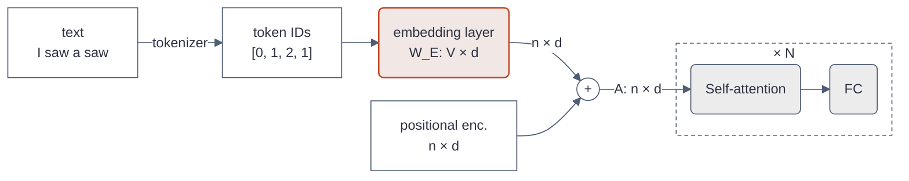
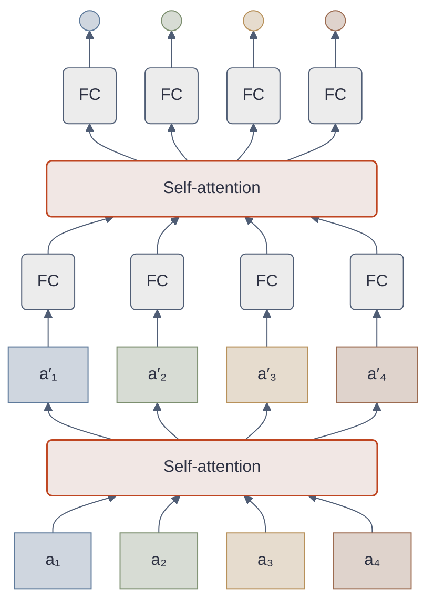

## Intro 
- def: a type of <span style="color:rgb(255, 0, 0)">sequence to sequence </span>DL layer, building blocks for transformer
- **Motivation**: FFNET always gives same output for same input, yet same word in a sentence could have different meaning 
	- eg. I saw看到 a saw鉅子 →  2 saw → same result
	- if feed whole context window as input $\rightarrow$ computation too heavy
### input

- tokenizer details: see [[Tokenization intuition & common types]]

sequence + **positional encoding** ($A_{n \times d}$ = token embeddings + $e_{n \times d}$ )
- $n$: number of tokens/vector
- $d$: size of each token/vector
- token embeddings $= X W_E$ → $(n \times V)(V \times d) = n \times d$ ($V$ = vocab size)
	- $X$: one-hot of token IDs, row $i$ = single 1 at column ID$_i$ → picks row ID$_i$ of $W_E$ 
		(in code: lookup `W_E[ids]`, skips multiplying 0s)
	- $W_E$: 1 row per vocab token → **big**, eg. Llama-3 8B: $128\text{k} \times 4096$ ≈ 525M params; random init → learned by backprop
- $e$: $\because$ <span style="color:rgb(255, 0, 0)">input is whole seq</span>, need vector of each position to be unique to keep position info
### output
sequence of **same size**($n \times d$ )
- intuition: $a'_i$ = token $i$ **re-written with context** (weighted avg. of every token in seq)
	- weight $\hat\alpha_{i,j}$: how relevant token $j$ is to token $i$, sums to 1 over $j$
	- $\therefore$ $a'_i$ sits at position $i$ but depends on **all** $a_1 \dots a_n$
- usually followed by FC: attention only mixes tokens (linear weighted avg) → FC adds **nonlinearity**, applied per token → alternate the two N times



## Intuition
### Key elements
- Each input $a_i$ is multiplied by **3 learned matrices $W_Q, W_K, W_V$** <span style="color:rgb(255, 0, 0)">shared by every position</span> (like a CNN kernel shared across pixels) to get 3 vectors
	- a **query** $q_i$
	- a **key** $k_i$
	- a **value** $v_i$. 

|             | role                                                 | search analogy |
| ----------- | ---------------------------------------------------- | -------------- |
| **Q** query | what this token is **looking for** in other tokens   | search terms   |
| **K** key   | what this token **offers** to be matched → relevance | page title     |
| **V** value | this token's **own content**, passed on once picked  | page content   |

$\rightarrow$ think of each as a <span style="font-weight:bold; color:rgb(255, 0, 0)">filter</span> to extract specific information of the input vector

### Procedure

ex. single head **self-attention layer** for position 1 (most simple self-att version)
	1. get $q_1$ by $a_1 W_Q$
	2. get $k_1$ to $k_n$ by $k_i = a_i W_K$
	3. <span style="color:rgb(255, 0, 0)">dot product</span> of query $q_1$ with each position's key $k_i$ 
		- good **representation for similarity** in word embedding space
		→ **attention score** $\alpha_{1,i}$ (how relevant is position $i$ to position 1). 
	4. get $v_i$ for each position by $v_i = a_i W_V$
	5. multiply each $v_i$ by its score $\alpha_{1,i}$ (scalar × vector), then sum over $i$
$\rightarrow$ the <span style="color:rgb(255, 0, 0)">weighted sum</span> is $a'_1$ = position 1 re-written with context. Every other position repeats this with its own query.
- note: for fixed scores, $a'_1$ is a **linear** combination of the $v_i$  $\therefore$ FC (**nonlinearity**) usually follows

![[self-attention-qkv.png|700]]


## Math

### One position

$$\alpha_{1,i} = q_1 \cdot k_i \qquad\qquad a'_1 = \sum_{i=1}^{n} \alpha_{1,i}\, v_i$$
- $a_i$: input vector of position $i$ (size $d$ )
- $n$ = sequence length
- $q_i = a_i W_Q$, $k_i = a_i W_K$ (size $d_k$) ; $v_i = a_i W_V$ (size $d_v$)
	- $W_Q, W_K$: $d \times d_k$ 
	- $W_V$: $d \times d_v$ 
	- $d_k$ self-defined (eg. 64), often $d_v = d_k$
- $\alpha_{1,i}$: attention score of position $i$ to position 1 → **scalar**
- $a'_1$: output of position 1, **size $d_v$**

### Single-head self-attention
- def: the simplest version of self-attention (usually model have multiple heads)
	- formula:
$$A' = \text{Attention}(A) = \text{softmax}\left(\frac{(AW_Q)(AW_K)^T}{\sqrt{d_k}}\right)(AW_V) = \text{softmax}\left(\frac{QK^T}{\sqrt{d_k}}\right)V$$

- $A$: combine input vectors into a matrix, size $n \times d$
	- $n$ = no. of inputs/tokens
- $Q = AW_Q$, $K = AW_K$ ($n \times d_k$), $V = AW_V$ ($n \times d_v$) → row $i$ = $q_i$, $k_i$, $v_i$
- $(AW_Q)(AW_K)^T = QK^T$
	- $n \times n$, also known as **attention matrix** (row: query, col: key) → entry $(i, j)$ = attention score $\alpha_{i,j} = q_i \cdot k_j$
- $\sqrt{d_k}$: scaling to **ensure reasonable range before softmax**, avoid too sharp distribution
	- $\because$ $q_i \cdot k_j$ sums $d_k$ terms → its variance grows with $d_k$ → large scores → softmax ≈ one-hot → tiny gradients
- softmax: activation over each row of scores → turns them into **attention weights** $\hat\alpha_{i,j}$ → $a'_i$ becomes a weighted avg. of all $v_j$ (more relevant → more weight)
	- note: other activations also work, eg. ReLU
- $A'$: $n \times d_v$, row $i$ = $a'_i$

### Multi-head self-attention
- def: $h$ single heads in parallel, each with its **own** $W_Q^i, W_K^i, W_V^i$ → concat outputs then $\times W_O$
$$\text{MultiHead}(A) = \underbrace{[\,\text{head}_1 \mid \text{head}_2 \mid \cdots \mid \text{head}_h\,]}_{\text{concat: } n \times d}\;W_O$$
	- $\text{head}_i$: $n \times d_k$ (n tokens, each a $d_k$ vector), $d = d_k \times h$ → concat all vectors to $n \times d$ → same cost as 1 head
	- $W_O$: $d \times d$, **learned** with $W_Q, W_K, W_V$ → mixes the $h$ head outputs per token
- eg. d = 512, h = 8 → d_k = 64
```
head_1: n × 64  ┐
head_2: n × 64  │  concat along feature dim
  ...           │  → n × 512
head_8: n × 64  ┘

row i (token i) = [ head_1[i] | head_2[i] | ... | head_8[i] ]   → 8 × 64 = 512
then × W_O (512 × 512) → n × 512
```
- why better: $h$ heads = $h$ relations at once
	- eg. "The animal didn't cross the street because **it** was tired" 
		→ head 1: it → animal, head 2: it → was
- why heads don't become identical
	- <span style="color:rgb(255, 0, 0)">random init</span>: different start → different gradients → different $W$ (identical init stays identical forever)
	- duplicate head adds nothing to $W_O$ → gradient pushes it toward what other heads miss
	- not guaranteed → in practice many heads are redundant & prunable (Michel et al. 2019)

### einops pseudo code
- syntax see [[einops]]
```python
import torch
from einops import einsum, rearrange

n, d, h = 4, 8, 2                              # 4 tokens, each a d-dim vector, 2 heads
A = torch.randn(n, d)                          # input (embedding + positional encoding)

def attention(Q, K, V):                        # "..." → works for 1 head (n k) or h heads (h n k)
    scores = einsum(Q, K, "... i k, ... j k -> ... i j") / Q.shape[-1]**0.5  # QKᵀ/√d_k, (n, n)
    return einsum(scores.softmax(-1), V, "... i j, ... j k -> ... i k")      # weighted sum of v_j

# single head: 1 set of 3 learned matrices, same W for every token
W_Q, W_K, W_V = torch.randn(3, d, d)
A_out = attention(A @ W_Q, A @ W_K, A @ W_V)   # (n, d), row i = a'_i

# multi-head: h sets of W stored side by side in 1 (d, d) matrix → split columns into heads
W_Q, W_K, W_V, W_O = torch.randn(4, d, d)
split = lambda X: rearrange(X, "n (h k) -> h n k", h=h)              # d_k = d/h
heads = attention(split(A @ W_Q), split(A @ W_K), split(A @ W_V))   # (h, n, d_k)
A_out = rearrange(heads, "h n k -> n (h k)") @ W_O                  # concat → mix, (n, d)
```

## Others

- High level, CNN & RNN are both a subset of self-attention. The only difference is self-attention compare the relevancy of ALL data at once (learn it's own receptive field for CNN)
	$\rightarrow$ self-attention has <span style="font-weight:bold; color:rgb(255, 0, 0)">high variation, low bias</span>  
- **Truncated** self-attention
	- motivation: input seq is too long to fit at once (eg. sound)